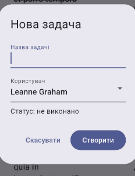

# TODO Manager

Додаток використовує REST API https://jsonplaceholder.typicode.com/ для отримання списку задач та користувачів. Користувач може переглядати задачі, створювати нові, редагувати їх, змінювати статус виконання та видаляти.

## Функціональні можливості
### Робота із задачами
- Отримання всіх задач через API.
- Відображення задач у вигляді списку.
- Створення нової задачі.
- Редагування назви задачі.
- Зміна статусу задачі.
- Видалення задачі.

### Робота з користувачами
- Отримання списку користувачів через API.
- Вибір конкретного користувача.
- Відображення задач вибраного користувача.

### Пошук та фільтрація
- Пошук задач за назвою.
- Фільтр усіх задач.
- Фільтр виконаних задач.
- Фільтр невиконаних задач.

### Статистика
- Загальна кількість задач.
- Кількість виконаних задач.
- Кількість невиконаних задач.
- Відображення прогресу виконання у вигляді смуги та відсотків.

### Додаткові можливості
- Оновлення списку задач.
- Оновлення списку за допомогою свайпу вниз.
- Відображення індикатора завантаження.
- Обробка помилок під час запитів до API.
- Повідомлення про успішні операції та помилки.
- Підтвердження перед видаленням задачі.

## Структура проєкту
```text
todo_manager/
│
├── lib/
│   ├── constants/
│   │   └── api_constants.dart
│   │
│   ├── models/
│   │   ├── app_user.dart
│   │   └── todo.dart
│   │
│   ├── screens/
│   │   └── home_screen.dart
│   │
│   ├── services/
│   │   └── api_service.dart
│   │
│   ├── widgets/
│   │   └── todo_tile.dart
│   │
│   └── main.dart
│
├── test/
│
├── android/
├── ios/
├── web/
│
├── pubspec.yaml
└── README.md
```

## Опис головних файлів

### lib/constants/api_constants.dart
Файл із константами для роботи з API. Містить основну адресу сервера, адреси ресурсів для задач і користувачів, а також час очікування відповіді від сервера.

### lib/models/todo.dart
Модель задачі. Містить такі поля:
- userId - ідентифікатор користувача.
- id - ідентифікатор задачі.
- title - назва задачі.
- completed - статус виконання.

### lib/models/app_user.dart
Модель користувача. Зберігає основну інформацію про користувача:
- id - ідентифікатор.
- name - ім'я.
- email - електронна пошта.

### lib/services/api_service.dart
Файл, який відповідає за взаємодію із сервером.
У ньому реалізовані HTTP-запити:
- GET - отримання задач та користувачів.
- POST - створення нової задачі.
- PUT - редагування задачі.
- PATCH - зміна статусу виконання.
- DELETE - видалення задачі.

### `lib/screens/home_screen.dart`
Головний екран додатка. Тут знаходиться основна логіка роботи із задачами:
- Завантаження даних із API.
- Відображення списку задач.
- Пошук та фільтрація.
- Вибір користувача.
- Створення, редагування та видалення задач.
- Відображення статистики.
- Обробка станів завантаження та помилок.

### `lib/widgets/todo_tile.dart`
Окремий віджет для відображення однієї задачі. Містить назву задачі, статус виконання, ім'я користувача та кнопку редагування.

### `pubspec.yaml`
Файл налаштувань Flutter-проєкту. Містить інформацію про залежності, версію SDK та підключені пакети.

## API
Для роботи додатка використовується JSONPlaceholder.

Основна адреса:
https://jsonplaceholder.typicode.com


Використовуються такі ресурси:
| Метод | Адреса | Призначення |
|---|---|---|
| GET | `/todos` | Отримання всіх задач |
| GET | `/todos?userId=1` | Отримання задач користувача |
| GET | `/users` | Отримання користувачів |
| POST | `/todos` | Створення задачі |
| PUT | `/todos/1` | Редагування задачі |
| PATCH | `/todos/1` | Зміна статусу задачі |
| DELETE | `/todos/1` | Видалення задачі |

## Інструкція із запуску

flutter pub get
flutter run

## Екрани
Головна сторінка


Додавання нової задачі


## ШІ
Під час створення застосунку ШІ не був використовуваний.